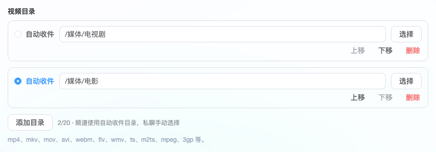
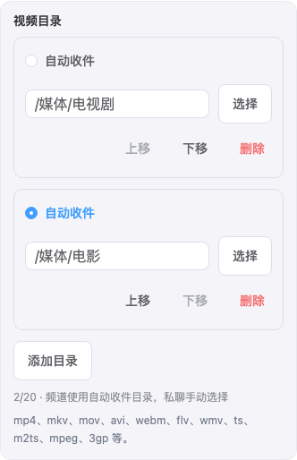
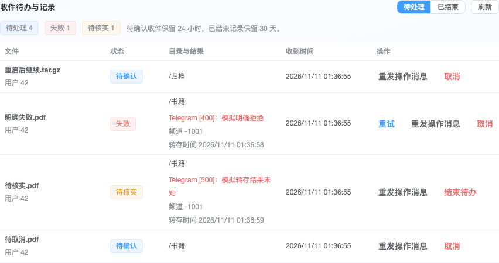
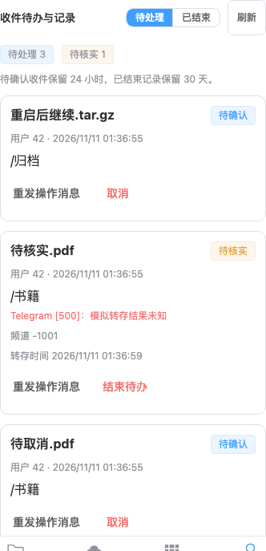

# Bot 收件多目录与重命名验收记录

验收日期：2026-11-11（Asia/Shanghai）。已实现用户确认的 [Q1～Q17 方案](bot-inbox-design.md)：所有类型支持多目录，私聊逐文件选目录、按需改名并确认存储，频道按指定自动目录收件，并提供持久待办与管理操作。

## 验证范围

基线提交为 `870bbde1b1a0ef2143b5d879f1306ef76c8262f9`。验证使用临时 SQLite、本地模拟 Bot API、实际 TGDrive 服务进程及生产构建的 Web 页面。模拟端点只监听 `127.0.0.1`，使用合成 Bot、频道、文件引用和账号；宿主在独立目录中读取空 `.env` 和明确提供的隔离配置。

开始时工作区已有搜索、分享、原生接口等未提交修改。隔离源码以基线归档为基础，叠加本次改动，再逆向剥离原有补丁；原工作区未执行这一步。原有补丁在工作区的反向应用检查仍通过，原有未跟踪文件保留。初次实现验收阶段尚未提交、推送或部署；后续 `v0.3.8` 提交前复检另行记录。

## 检查结果

| 检查 | 结果 |
| --- | --- |
| 隔离源码 Rust 全量回归 | **408 通过、0 失败、6 个原有人工夹具未启用** |
| 实际工作区 Rust 全量回归（默认并发） | **412 通过、0 失败、6 个原有人工夹具未启用** |
| 收件行为回归（包含在全量测试中） | **29 通过** |
| 隔离前端全量回归 | **37 个文件、215 项测试通过** |
| 前端类型检查与生产构建 | **通过**，实际 Web 验收使用该构建 |
| 隔离源码二进制构建 | **通过** |
| 实际工作区二进制构建 | **重新编译通过**，产物对应当前工作区源码 |
| 实际 Web 页面与后台轮询联调 | **6 组场景通过，浏览器错误为 0** |
| 差异及原有修改核对 | `git diff --check`、原有补丁反向应用检查通过 |

Rust 全量回归使用 `cargo test --locked --offline --quiet -- --test-threads=4`。6 个未启用的测试是原有浏览器、原生客户端、实媒体探测与真实 Telegram 夹具，不属于本次模拟收件验收。

混合工作区复检时，现有 `proxy::tests::mtproto_tunnels_support_http_connect_and_socks5_without_losing_early_bytes` 的端口关闭断言重复失败：一次 `yield_now` 无法保证已中止任务完成监听器释放。[该测试](../src/proxy/tests.rs) 已改为最多等待 1 秒观察端口关闭，仍要求实际连接失败；代理实现未修改。修正后，工作区按默认并发完成 412 项全量回归。隔离副本与工作区共享编译目录会复用同名包产物，最终工作区复检前已清理本项目的编译缓存，以重新编译实际工作区源码。

## v0.3.8 提交前复检

2026-11-11 将宿主版本从 `0.3.7` 更新至 `0.3.8`，同步更新 `Cargo.toml` 与 `Cargo.lock`。从独立暂存树导出完整发布源码，重新运行以下检查；暂存树包含 38 个本次收件及版本更新文件，`src/api.rs` 仅包含新增收件路由，`src/db.rs` 仅包含新增收件模块声明。原有搜索、分享和原生接口修改及其未跟踪文件继续保留在原工作区，校验值一致。

| 检查 | 结果 |
| --- | --- |
| 发布源码 Rust 全量回归（默认并发） | **408 通过、0 失败、6 个原有人工夹具未启用** |
| 发布源码前端全量回归 | **37 个文件、215 项测试通过** |
| 发布源码前端类型检查与生产构建 | **通过** |
| 发布源码二进制构建 | **通过**，编译输出明确为导出源码中的 `tgdrive v0.3.8` |
| 版本、暂存差异及原有改动校验 | **通过** |

复检命令为 `cargo test --locked --offline --quiet`、`cargo build --locked --offline`、`npm test` 和 `npm run check`。独立暂存索引、导出源码、校验清单及复检日志保存在本地 `tmp/bot-inbox-release-20261111-uL646t/`，不纳入版本提交。

## 已验证的关键行为

| 场景 | 观察结果 |
| --- | --- |
| 多目录和单目录收件 | 只展示匹配类型的候选；多目录手动点选，单目录预选；确认前既没有频道副本，也没有网盘上传占位 |
| 重命名与文件归属 | 指定提示消息的回复只修改对应文件；重放回复不会形成新收件；原后缀及原始分类保留；规则变更不改变已记录的多段后缀；等待改名时拒绝确认，取消改名保留此前名称 |
| 视频质量 | 接收消息和转存返回均按有效引用及尺寸择优；实际模拟 `sendVideo` 往返保存最高质量版本 |
| 同名及重复确认 | 重复确认只转存一次；转存期间产生同名文件也不会被覆盖；实际路径自动编号，`tar.gz` 等完整后缀保留 |
| 目录变化 | 改名或移动跟随节点身份，重新确认新路径；删除目录不重建旧路径；重试登记复用已知副本；无效配置和并发版本冲突不部分保存其他字段 |
| 暂停、重启及额度 | 关闭入口暂停未开始待办；正常重启保留选择；每用户 50 份额度跨 Bot 计算，实例 500 份；超限时重复来源更新仍幂等 |
| 失败与未知结果 | 明确失败可手动重试；5xx 或中断的未知结果禁止重发媒体；开始转存后不能取消；普通过期不自动存储；待核实状态须人工结束 |
| Bot 切换 | 游标、来源请求及失败尝试按 Bot 隔离；旧待办失效；结束通知使用原目标凭据且不再提供按钮；旧存储 Bot 的频道消息不会被另一次自动收件登记 |
| 备份恢复和记录清理 | 正常重启与恢复候选区别处理；七种未完成状态全部失效；明文下载及远端快照结束旧待办而不改变在线待办；已结束记录清理不影响网盘文件 |

核心回归位于 [交互收件测试](../src/inbox/interactive_tests.rs)、[收件入口测试](../src/inbox.rs)、[备份测试](../src/backup.rs)、[恢复测试](../src/restore/tests.rs) 和 [管理页面测试](../frontend/src/views/admin/Inbox.test.ts)。

## 实际服务与页面联调

1. 在桌面管理页添加、重排两条视频目录并保存，确认自动收件目标仍指向电影目录。
2. 通过真实后台长轮询接收五份独立待办，确认前媒体请求数为 0；选目录、回复改名提示并确认后，最高质量视频存入电视剧目录。
3. 管理页同时展示改名后的名称及原始文件名，便于核实频道内容；模拟明确拒绝与结果未知，页面分别显示失败和待核实；从管理页安全重试明确失败，未知结果没有重试入口。
4. 在 390 像素手机页面检查目录编辑和待办卡片，页面无横向溢出；取消普通待办，核实提示后结束未知结果。
5. 实际下载数据库备份，直接读取返回的 SQLite 文件，确认没有未结束请求；在线待办仍为待确认。
6. 停止并重新启动隔离宿主，原待办及选择保留，没有自动复制；重启后确认存储成功。

桌面验证视口为 1440×1000，手机交互验证视口为 390×844；手机待办截图使用同一宽度的较高视口完整展示卡片。所有截图均使用上述合成数据。

桌面目录编辑：

手机目录编辑：

桌面待办管理：

手机待办管理：

## 运行边界

本报告中的本地验收未使用真实 Telegram 凭据，也未在 Telegram 官方客户端中验收按钮、改名输入和真实转存。本地未执行完整镜像、多架构构建及生产部署；版本标签会触发仓库现有的 `docker-release` 流水线，其构建及镜像发布结果以对应 CI 运行状态为准。实际 Bot API 的权限、限流、频道状态和客户端显示仍需在部署后的真实环境验收。

本次创建的隔离宿主和模拟 Bot 进程已停止。回归日志、源码校验值、Web 联调记录及复现脚本保存在本地 `tmp/bot-inbox-implementation-EPwsBy2O/`；源码与合成数据库使用该目录 `validation-root.txt` 指向的临时验证根目录。使用说明已更新至 [部署文档](deployment.md#交互收件的使用与维护) 和 [备份恢复说明](backup-restore.md)。
