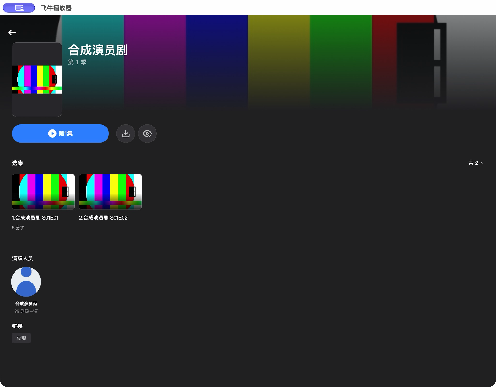

# 飞牛演员与人物资料验收

日期：2026-11-14 至 2026-11-15（北京时间）。目标宿主 `0.3.12`、飞牛管理插件 `0.1.5`、影视刮削 `0.1.4`。用户已确认[演员设计](fntv-actors-design.md) Q1–Q16并授权实现和本机官方客户端验收。

## 实现结果

宿主读取 NFO 的多名演员、角色、顺序、本地头像、人物简介和来源 ID，建立当前授权作品的人员关系。缺可靠人物 ID 时按完整姓名归并；Gfriends 的姓名 ID 同样按姓名处理。演员列表去除空姓名并合并同人物的重复关系，保留作品各自的角色和顺序。

人物详情和作品列表复用官方客户端实际请求的 `/v/api/v1/person/list/{item_guid}`、`/v/api/v1/person/{person_guid}`、`/v/api/v1/person/item/list`，头像通过 `/v/api/v1/sys/img/tgdrive-person/{guid}` 返回。人物作品覆盖全部已授权媒体库，同文件重叠库去重，电影保持独立视频条目，电视剧汇总为整剧。默认最近入库优先，支持标题及入库时间的排序、分页；官方客户端传来的 `update_time` 使用约定的最近入库回退。

剧和季优先使用剧目录的 `tvshow.nfo` 演员；缺少时汇总已收录的本剧、本季单集演员。单集自己的演员表优先，缺少时继承剧级。头像和简介分别使用最近更新的有效授权资料；NFO 移动、改名、改写或失去授权后，不等待索引更新就停止使用其旧人物资料。NFO 头像只解析为资料目录及后代的本地文件，拒绝网络地址和越界路径；实际图像读取后再次核对授权和作品关联。

刮削执行在 NFO 前补人物，后端查询整片最多 40 秒、最多三项并发。只有唯一精确同名身份参与补取，同来源同 ID 的重复候选去重，近似姓名和多身份同名不自动选择。每张成功获取的 JPEG 暂存在宿主，再由页面逐张推进受限上传；单张最多 128 KiB、整片图片暂存最多 8 MiB。头像提交成功才写 NFO 引用，新文件由视频基本名摘要与操作项摘要命名，重刮保留旧文件，生成头像按所属视频组同行。

人物未匹配、超时、无图或明确上传拒绝仍保留姓名并继续 NFO、影片海报；发送结果不确定仍停止并标为待核实。完成页及重开记录保留人物补充摘要。可选人物简介超过 NFO 整份 1 MiB 预算时不静默截断，保留完整姓名及可用头像并记录原因。

## 本次代码与数据边界

- 实现阶段宿主基线 `29c42e7239a1debe5fd2edeb13e6d7e24d1bc21f`，插件基线 `65c43e934d19c348219ca1f30ec5a15f6f2bb9c3`；最初在未提交工作区验证。
- 宿主开始时已有搜索、分享及原生列表相关改动。本次没有覆盖这些改动；下列实现阶段的全量 Rust 回归包含它们。提交前另行隔离本次文件，结果记录于文末。
- 所有文件写入均使用已核对身份的临时 SQLite、内存 Telegram和合成视频。没有操作日常数据库、真实 Telegram 或生产网盘。
- Node.js 使用固定 `22.22.0`。五款插件从新的空目录构建，沙箱验收使用该轮安装包；根目录分发资产在页面验收完成后另行生成。
- 既有索引 JSON 保持可读，未增加用户不需要的旧演员资料专项迁移；已有影片可重新刮削生成新人物资料。

## 实现阶段程序与浏览器验证

| 检查 | 实际结果 |
| --- | --- |
| `cargo test --locked` | 最终当前工作区 451 项通过、6 项既有显式忽略，零失败。 |
| `cargo build --locked` | 非测试宿主二进制构建通过。 |
| 插件 `npm ci`、`npm run check` | 固定 Node.js 22.22.0，安装、严格类型检查与五款插件独立构建通过。 |
| 插件 `npm test` | 67 个测试文件、719 项通过。 |
| 插件 `npm run typecheck` | 新增沙箱测试后的类型检查通过。 |
| 插件独立目录与 SHA256SUMS 校验 | 五包及完整清单通过。 |
| 宿主前端 `npm run check`、`npm test` | 类型检查、构建及 215 项测试通过。 |
| 飞牛与刮削沙箱 E2E | 2026-11-15 00:25–00:28，15 项通过，零失败、零跳过、零重试通过项。 |

最终根目录安装包在页面验收完成后重新生成，和上述已验收候选逐字节一致；其余三款插件的目录条目及包摘要与本轮开始时一致，完整目录和 `SHA256SUMS` 校验通过。

| 本地分发产物 | 大小 | SHA-256 |
| --- | ---: | --- |
| `fntv-0.1.5.tgapp` | 16494 字节 | `5888d8daf954073440e1b95c88a64dacf75c5fa23db88847a2ab940ea7bd3765` |
| `media-scraper-0.1.4.tgapp` | 231803 字节 | `68e73a22cdef9c7ea37e997eb495762f309ac1abccfdbcd87afb3b281fc2f86d` |
| `catalog.json` | 11405 字节 | `7bc65fefaa60cab3c690b80237a01d4885aa7e6099222764f764d21fdec8496a` |

新增回归覆盖 XML 嵌套字段和长简介、唯一精确人物匹配、缺图、整体查询预算、有限并发、成功提交后引用、普通拒绝与不确定提交区别、取消上传、跨库与重叠库、剧季集继承、客串关联整剧、最新资料回退，以及资料移动／改名后即时失效。沙箱验证真实应用页面、重开操作记录、刚写入头像的飞牛消费和 Cinema 的原有完整资料与播放链路。

沙箱首轮 14 项通过、1 项发现生成头像名使用了包含非十六进制字符的操作项 ID，不能被同组资料识别规则接纳。已改为操作项摘要，并新增回归；最终 15 项全部通过。

## 公共 MetaTube

通过当前默认 `https://metatube-server.hf.space/`，真实宿主、真实插件沙箱与合成媒体完成了影片及人物补充，没有携带账号、Cookie 或 Token。

| 合成媒体文件名 | 人物结果 | 已提交演员 JPEG |
| --- | --- | --- |
| `IPX-001` | 一名演员，唯一精确匹配，头像 1/1 | 34262 字节 |
| `SONE-614` | 一名演员，唯一精确匹配，头像 1/1 | 27607 字节 |

另有三条实际番号影片通过既有默认后端补齐 NFO 并保留海报。默认 Gfriends 可以补部分头像，其人物简介通常为空，不承诺能补出角色或简介；现有或其他工具生成的 NFO 有对应字段时可以显示。

## 官方客户端实际结果

本机官方飞牛播放器 `com.trim.media.ios`、`1.12.3 (1123003)`，iOS/iPadOS 包在 Mac 的兼容运行路径。继续使用独立合成账号和回环服务，原生请求仅记录方法、路径、响应状态、合成作品和白名单排序字段，不保存鉴权头或密码。

- 电影详情显示两名合成演员、各自角色、正确头像与缺图占位。缺图人物仍能点击进入人物页并浏览其关联电影。
- 合成演员甲人物页显示较新头像及较新完整简介，并浏览两部电影及只作为单集客串关联到的整剧；点击整剧可进入季页。
- 季详情显示来自 `tvshow.nfo` 的合成演员丙、剧级角色和头像，点击后的人物页正确关联到整剧。
- 最终原生请求确认 `/person/item/list` 使用 `job=Actor`、`page_size=200`、`sort_column=update_time`、`sort_type=desc`。返回及画面顺序均为整剧、第二部、第一部，与合成入库日期的降序一致。其他岗位请求返回空列表。

对应的白名单请求及返回顺序另保存在[原生人员请求证据](fntv-actors-native-20261115.json)。

整剧详情页在该客户端未发出演员列表请求；季页单集入口主要用于播放，长按菜单只有观看标记和收藏，没有独立单集演员详情入口。剧与单集的宿主人员接口及继承规则已通过程序验证，但不能宣称这两个官方页面实际显示演员。其他设备与客户端版本未在本轮验收。

原始请求、完整命令日志、沙箱报告与截图保存在本机忽略目录 `tmp/fntv-actors-validation-20261114-TLketH/`。前述结果记录实现和本机客户端验收范围，镜像发布及日常服务部署不属于客户端验收结果。

## 提交前隔离验证

2026-11-15 获得提交、推送及递增标签授权后，从上述宿主基线建立独立工作区，仅复制本次演员功能、相关测试、版本及文档。原工作区的 11 个搜索、分享相关文件逐个保存摘要，本次提交不包含它们。宿主修订版本为 `0.3.12`，发布提交使用 `v0.3.12` 标签定位。

| 隔离源码检查 | 实际结果 |
| --- | --- |
| `cargo fmt --all --check` | 退出 0。 |
| `cargo clippy --locked --all-targets -- -D warnings` | 修正剧级演员缓存的 Entry 写法后退出 0，无警告。 |
| `cargo test --locked` | 447 项通过、6 项既有显式忽略，零失败。该数量只对应本次提交范围。 |
| `cargo build --locked` | 非测试宿主二进制构建退出 0。 |
| 宿主前端 `npm ci`、`npm run check`、`npm test` | 固定 Node.js 22.22.0，安装、类型检查、构建及 215 项测试通过。 |
| 插件五步分发门禁 | 依序退出 0，719 项单元测试通过；新空目录构建的五包与根目录分发资产逐字节一致。 |

插件正式分发以本次已提交宿主的完整 SHA 完成本机 E2E，再记录到插件 `compatibility.json`。对应完整套件结果及发布时实际宿主提交见[飞牛 0.1.5 与影视刮削 0.1.4 验收记录](https://github.com/lengyuesky/tgdrive-app/blob/main/docs/fntv-actors-0.1.5-validation.md)。隔离检查日志保存在本机忽略目录 `tmp/fntv-actors-release-20261115-GeNBGd/`。
