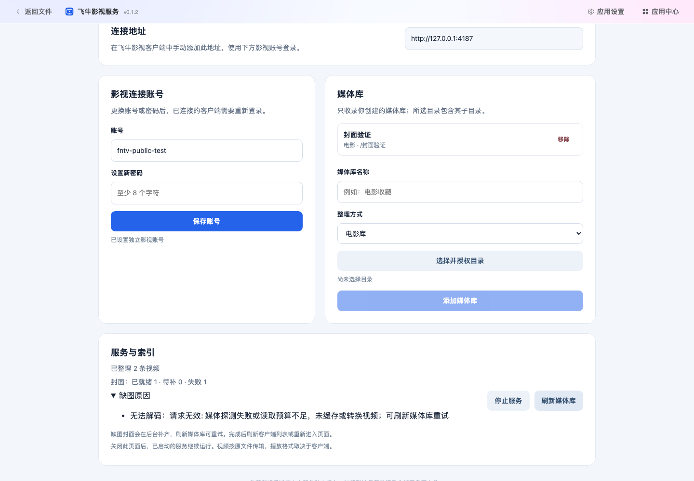
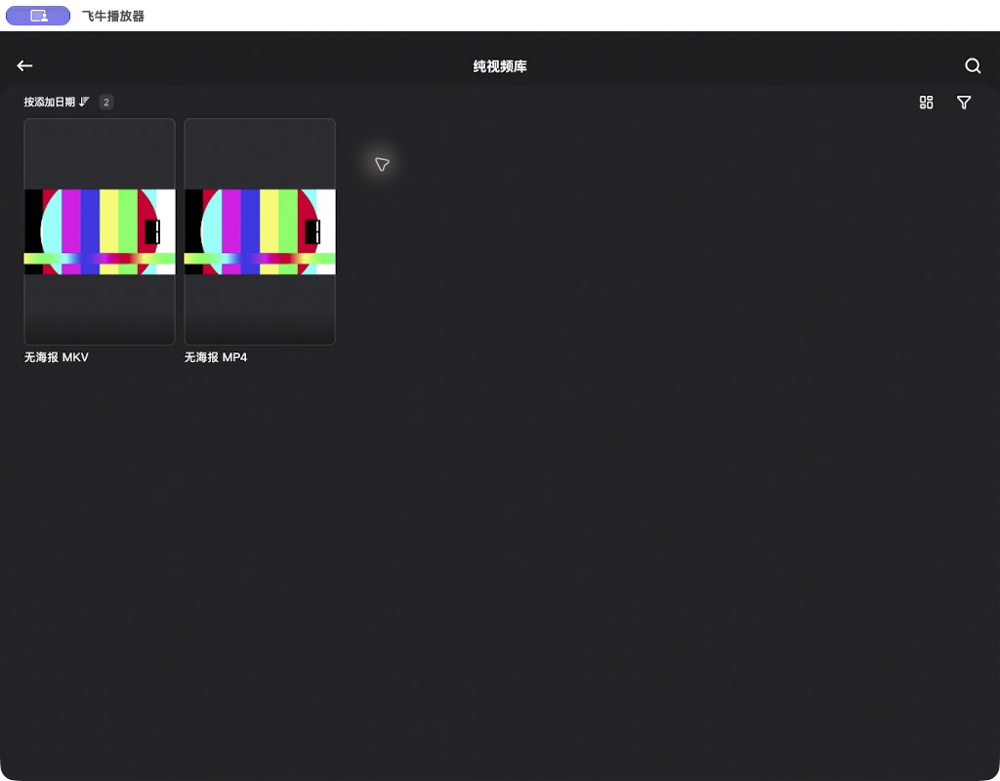

# 无海报视频封面本地验收

2026-11-07，Asia/Shanghai。用户确认完整设计并授权实现后，本地候选已实现同目录海报 → Telegram 已附带小图 → 受限截帧的封面来源顺序。程序测试、真实管理页、完整临时宿主协议、两架构媒体组件及指定官方客户端画面验证通过。官方 `1.12.3 (1123003)` 在独立合成连接中，确认补图后重新进入列表取得封面，详情、继续观看、剧、季及单集均显示真实图片。

本记录前期部分对应未提交候选。用户随后授权提交及推送，宿主功能已独立提交为 `6ab85fc57f31b568571ad271ccddfe60b37bded4`，插件 `compatibility.json` 更新为实际完成集成的该提交；正式 FNTV `0.1.2` 包与此前候选逐字节相同。提交阶段的完整证据见后文，不构成日常服务部署，已有宿主标签未改动。

## 源码与候选身份

| 项目 | 实际值 |
| --- | --- |
| 宿主 base SHA | `c1cbc486837188cf4873d4da1be462c0a326ce16` |
| 宿主目标版本 | `0.3.7`，工作区有未提交修改 |
| 插件 base SHA | `519ef5a357986867eddf516f5724f8640bcdf1dc` |
| 插件候选 | `fntv 0.1.2`，API v2，最低宿主 `0.3.7` |
| 候选包 | `tmp/fntv-covers-validation-20261107/plugin-build/apps/fntv-0.1.2.tgapp` |
| 候选包大小 | 12,471 字节 |
| 候选包 SHA-256 | `8ef1d3087b684d31890337799961db07d2211b3c45040f6e86ca02449fd9dffa` |
| 提交交付的宿主 SHA | `6ab85fc57f31b568571ad271ccddfe60b37bded4` |
| 对应提交树 | `45e1ad098f5ba1b318d75098816acea688686c4d` |

基线存在搜索、分享、原生接口和相关夹具等用户改动。本轮保全这些改动，只在已有修改的 `src/api.rs` 增加 `thumbnail_bytes` 的导出。未重置工作区或进行全仓库格式化。

全部验证使用合成视频、图片和文本、临时 SQLite、内存 Telegram，以及任务专属输出目录。没有使用生产账号、生产数据库、真实网盘媒体或真实 Telegram 附件。

## 实现行为

- 所有已入库且缺少可用同目录海报的视频进入补图范围，是否有 NFO 不影响补图。
- 索引先发布，后台单并发补图，前台播放和探测优先。停服、撤权及更新取消旧任务，旧代次不能发布图片。
- 每次截帧共享 8 MiB／10 秒总预算，最多约 1、3、5 秒三处尝试；短视频调整位置，跳过黑帧。JPEG 最长边 640 像素、最多 256 KiB，保留显示比例。
- 图片和任务状态由 `fntv` 独立拥有；缓存上限 256 MiB、重启复用、卸载清理。源版本或缩略图引用变化使结果失效，未过期成功结果可复用。
- 临时网络错误额外重试两次，间隔 5 分钟、30 分钟；终止性失败保留客户端占位及原文件入口。
- 管理页显示就绪、待补、失败和重试数量及缺图原因。用户 Q13 已确认不加按钮，沿用“刷新媒体库”；Q14 接受客户端刷新或重新进入页面后取得封面。

完整约定见 [封面设计](fntv-cover-design.md)。

## 实际命令与结果

下列命令均在本次持续任务中执行；版本工具为 Node.js 22.22.0，Rust 使用锁定依赖，本机 FFmpeg／FFprobe 来自已安装工具。

| 检查 | 退出结果与范围 |
| --- | --- |
| 宿主 `cargo test --locked` | 退出 0；392 通过、6 个显式集成夹具忽略 |
| 宿主 `cargo clippy --locked --all-targets -- -D warnings` | 退出 0 |
| 宿主 `cargo build --locked` | 退出 0；普通 `tgdrive 0.3.7` 二进制编译通过，未启动日常服务；日志 `host-build.log` |
| 两项显式真实 FFprobe 测试 | 退出 0；2 通过，覆盖真实 MP4／MKV、缓存、并发及超时取消 |
| 宿主前端 `npm ci`、`npm run build` | 均退出 0 |
| 插件 `npm ci`、`npm run check` | 均退出 0；构建通过 `TGDRIVE_APP_BUILD_OUTPUT` 写入独立候选目录 |
| 插件 `npm test` | 退出 0；63 个文件、645 项全部通过，日志 `tmp/fntv-covers-validation-20261107/plugin-tests.log` |
| 添加封面浏览器用例后 `npm run typecheck` | 退出 0 |
| `npm run test:e2e -- tests/browser/fntv.spec.ts` | 退出 0；3 项通过，日志 `browser-fntv.log` |
| `applications.spec.ts`、`cinema-lifecycle.spec.ts`、`cinema-art.spec.ts`、`platform-integration.spec.ts` | 退出 0；10 项通过、1 项原有按需截图生成用例跳过，日志 `browser-shared.log` |
| 完整临时宿主协议检查 | 退出 0；候选包安装、6 条封面、详情、继续观看、剧、季及原文件 Range 通过，详见下节 |
| 指定官方客户端与可暂停补图的显式宿主夹具 | 画面验收完成；夹具正常停止并退出 0，覆盖占位变为封面、详情、实际播放后的继续观看、剧季和三种图片来源 |
| 新增夹具控制与脱敏请求记录后，`cargo clippy --locked --all-targets -- -D warnings` | 退出 0；日志 `native-client-gBTKJA/clippy.log` |
| 正式目录与候选目录 `npm run catalog -- verify <catalog.json>` | 两处均退出 0，各核对四款插件及本地包 |
| 正式目录与候选目录 `sha256sum -c SHA256SUMS` | 两处均退出 0，四包及目录全部匹配 |

macOS 缺少 GNU `sha256sum`。本轮只在任务目录建立调用 `/usr/bin/shasum -a 256` 的兼容入口，执行真实 SHA-256 校验；没有改动系统工具。前次完整插件测试中的旧版本断言及环境入口问题已修正，上表记录最终一次完整 645 项通过结果。

15 项新增封面集成测试覆盖：无效海报回退、Telegram 小图不读取原视频及引用变化、真实限额 JPEG、黑帧、单帧短视频、非方形像素显示比例、失败保留原字节读取、前台优先、超时清理、停止及重启恢复、卸载缓存清理、剧季代表图、撤权中断和持久失败退避。封面状态库另有独立回归。

## 管理页与完整宿主协议

浏览器夹具先核对 `/__apps_fixture` 身份，使用真正的 `fntv 0.1.2` 候选包。验证公开目录安装、首次授权、账号及媒体库配置、主动启动、关闭管理页持续运行、停止撤销登录，以及真实 `0.1.0` 候选包升级后保留数据和运行状态。

新增用例在独立合成目录内放入一个没有 NFO 或图片的有效 MP4，以及一个故意损坏的 MP4 文本文件。后台结果为就绪 1、失败 1；管理页显示来自宿主的实际失败原因。刷新会重试失败项，成功图片 URI 保持不变；缺图文件的原字节 Range 仍返回 206，生成图片返回真实 JPEG。

完整宿主夹具使用 `apps::tests::fntv_native::fntv_native_fixture`，启动前校验 `__fntv_synthetic.json` 和每个合成素材的 SHA-256，动态绑定回环端口，启动时未预装 FNTV。检查脚本先核对 `/__fntv_fixture` 的 `synthetic=true`、`telegram=memory`、宿主 `0.3.7`，再登录合成主站账号并导入实际候选包。

| 媒体 | 来源 | 实际 JPEG |
| --- | --- | --- |
| 电影 MP4、MKV 各一条 | 同目录海报 | 各 11,345 字节、640×360，与合成海报原字节完全一致 |
| 无海报 MP4、MKV 各一条 | 受限截帧 | 各 26,640 字节、640×360，与海报内容不同 |
| 有附件小图的 MP4 | 模拟 Telegram 缩略图引用 | 11,345 字节、640×360，与附件原字节完全一致 |
| 无海报首集 | 受限截帧 | 26,640 字节、640×360，剧和季返回同一图片身份 |

最终状态为就绪 6、待补 0、失败 0，缓存 113,955 字节。检查列表和详情图片、剧 → 季 → 集的代表图，以及保存 7.75 秒后继续观看列表的同一图片；兼容协议显示整数秒 7。原文件 `bytes=4096-5119` 返回 206、1,024 字节。检查结束时活动读取者为 0；该窗口的合成上游累计请求 3,648,322 字节，含补图、探测及 Range。

任务证据位于 `tmp/fntv-covers-validation-20261107/native/`：`startup.json`、`protocol-report.json`、`image-dimensions.json`、实际返回的六张 JPEG 及最终清理统计。**这些是宿主程序协议证据，不能替代官方客户端已经显示图片的证据。**

核对夹具身份后调用专用停止入口，返回 204；夹具测试正常退出 0，最终活动读取者为 0。浏览器夹具和原生夹具的临时端口均已释放，媒体组件验证容器没有遗留。此前锁屏期间未创建客户端连接；解锁后的原生验收另用新的合成连接，未改动已有真实连接。

## 官方客户端新增画面验收

锁屏解除后，重新核对已安装应用及运行中兼容包的公开 `Info.plist`：bundle ID 为 `com.trim.media.ios`，版本 `1.12.3`，构建 `1123003`，平台 `iPhoneOS`。本轮使用该 iOS／iPadOS 包在 Mac 上运行，不扩展为原生 macOS、TV 或其他设备通过。

本轮启动新的 `apps::tests::fntv_native::fntv_native_fixture`，动态回环端口与临时 SQLite 均独立。安装同一个 SHA-256 为 `8ef1d3…fd9dffa` 的实际 `fntv 0.1.2` 候选包，授权合成根目录并设置合成影视账号。客户端关闭“记住密码”，使用本地 HTTP 连接，没有使用真实账号或真实文件。

为验证缺图转换，显式夹具通过 `TGDRIVE_FNTV_FIXTURE_PAUSE_COVERS=1` 暂时持有后台补图互斥锁。它只暂停测试中的后台工作，不修改生产封面结果或返回内容。索引正常发布，初始状态为就绪 0、待补 6，官方客户端显示真实占位卡片。通过仅存在于测试夹具的释放入口允许正常后台任务运行后，状态变为就绪 6、待补 0、失败 0；当前停留页仍是占位，返回首页后重新进入纯视频库，MP4 和 MKV 均显示截帧图片。该流程满足用户 Q14 确认的重新进入页面标准，没有将停留页面自动更新作为通过项。

| 场景 | 官方客户端观察 | 新证据 |
| --- | --- | --- |
| 无海报 MP4／MKV | 补图前是胶片占位；补图后重新进入列表显示真实视频截图 | [补图前](images/fntv-cover-before-native-20261107.jpg)、[重新进入后](images/fntv-cover-after-native-20261107.jpg) |
| 纯视频详情 | 顶部展示同一截帧封面，保留播放入口 | [详情](images/fntv-cover-detail-native-20261107.jpg) |
| 继续观看 | 官方客户端实际播放 MP4 并退出后，首页继续观看卡片显示相同封面 | [继续观看](images/fntv-cover-continue-native-20261107.jpg) |
| 剧与季 | 剧列表、剧详情以及第 1 季卡片显示该剧集截图 | [剧详情和季卡片](images/fntv-cover-show-native-20261107.jpg) |
| 季与单集 | 季页顶部代表图及首集缩略图均显示截图 | [季和单集](images/fntv-cover-season-native-20261107.jpg) |
| Telegram 已附带小图 | 只有模拟缩略图引用的 MP4 显示附件图片 | [小图来源](images/fntv-cover-telegram-native-20261107.jpg) |
| 同目录海报 | 两条电影显示原有合成海报 | [海报来源](images/fntv-cover-poster-native-20261107.jpg) |

播放器实际解码了合成 MP4，退出后服务保存最近有效上报的 227 秒，首页出现继续观看入口。本轮只据此验证该卡片的封面及播放不受补图影响；退出位置与最后上报位置仍遵循原先已说明的周期上报语义，不伪造精确退出时刻。

夹具记录路径、方法、响应状态和客户端公开 User-Agent，不记录查询参数、请求体、密码、Cookie 或鉴权头。官方客户端共留下 354 条协议请求，三种来源的六个封面身份都存在实际成功图片请求。10 次封面请求中有 9 次 200、1 次播放器 Alamofire 图片预取 401；列表、详情和继续观看的对应请求及画面成功。该额外预取请求没有作为成功项，也没有为它放宽现有影视鉴权。

原始新证据位于 `tmp/fntv-covers-validation-20261107/native-client-gBTKJA/`：`setup-report.json`、`release-report.json`、`ui-events.jsonl`、客户端截图、`native-requests.jsonl`、`evidence-report.json`、实际返回的六张图片和 `acceptance-summary.json`。后置程序检查确认海报及小图与附件原字节相同，截帧图片为 26,640 字节，继续观看使用同一个图片身份；它与官方客户端请求及截图交叉对应。

验收后核对该夹具身份并调用停止入口，返回 204；测试退出 0，最终活动读取者为 0，临时端口已释放。合成服务和影视会话均已失效，未清理或修改客户端已有真实连接。

## Docker 媒体组件

最初的基础镜像解析被本机 Docker daemon 代理超时阻断，原失败日志保留为 `docker/build-arm64.log` 和 `docker/build-amd64.log`。本轮未修改全局代理或重启 Docker；由宿主直接下载公共基础镜像并加载到任务独立标签，随后在本次构建中清空代理参数。

两种架构都执行生产 Dockerfile 的 `media-probe` 阶段，复制 FFprobe、FFmpeg 和完整动态依赖，再放入对应 distroless Debian 12 验证镜像，以 `1000:1000` 用户、`--network none` 运行。ARM64 在本机 Linux ARM64 环境运行，AMD64 通过 OrbStack 的架构兼容执行；没有把 AMD64 称为原生 runner 验证。

| 架构 | 验证镜像 ID | 结果 |
| --- | --- | --- |
| ARM64 | `sha256:2c6158baf263148d8bdf8a52dabb3b43138807f588a4d478b2f5a40747124cad` | 构建退出 0；WAV 探测、合成 H.264 MP4、JPEG 解码与探测全部通过 |
| AMD64 | `sha256:67218870a2e409a76f379eafd182e7b6853422ea7e85205840092ef894b95bf3` | 构建退出 0；相同检查全部通过 |

两者均正确识别一秒 `pcm_s16le` WAV，并生成 64×64、248 字节的 JPEG。新工作流将同样的 H.264 → JPEG 检查用于未来的完整镜像 CI。当前本地结果只覆盖这两个媒体组件镜像，**没有重建并验证完整两架构 TGDrive 候选镜像**。

命令和退出结果保存在任务的 `docker/build-local-*.log`、`docker/base-images.json` 及 `docker/smoke-*/report.json`；合成素材同时保留。

## 验证边界

此前原生工具两次报告 Mac 锁屏且自动解锁失败，本轮没有绕过锁屏；用户继续任务、解锁后已完成上述新画面验收。该客户端在当前页面停留时不会因后台状态完成而自动取得本轮缺图；重新进入列表已通过。首页先前加载的媒体库拼图仍可保留旧页面模型，本轮不宣称其在后台完成时自动更新。

2026-11-06 的旧客户端截图只证明旧同目录海报和原播放协议，未作为本轮封面通过证据。真实 Telegram 附件、日常服务、其他设备、生产负载和完整候选 Docker 镜像均未验收；当前小图来源使用内存 Telegram 的合成附件。本轮按后续授权提交源码和插件目录，没有移动已有标签、创建新的宿主标签或部署日常服务。

## 提交门禁与源码隔离

用户在新增客户端验收完成后授权“提交并推送”。本次只暂存封面功能、对应测试、构建组件及文档；`src/api.rs` 只暂存 `thumbnail_bytes` 导出，搜索及分享路由保留在未暂存差异中。原有搜索、分享、原生接口和相关夹具等 12 个文件的内容及执行位在提交前后逐项一致。

功能提交为 `6ab85fc57f31b568571ad271ccddfe60b37bded4`，包含 34 个本轮修改文件。使用 `git archive` 导出的源码运行完整集成，347 个文件的 Git blob 与执行位全部匹配提交树 `45e1ad098f5ba1b318d75098816acea688686c4d`。这份源码没有未提交的搜索、分享模块，仍能独立通过测试；后续验收记录更新只涉及文档，插件继续固定这一已验证功能提交。

| 提交门禁 | 退出结果 |
| --- | --- |
| 独立源码 `cargo test --locked` | 0；388 通过、6 个显式集成夹具忽略 |
| 独立源码 `cargo clippy --locked --all-targets -- -D warnings` | 0 |
| 独立源码宿主前端 `npm ci`、`npm run build` | 均为 0 |
| 插件 `npm ci`、`npm run check`、`npm test` | 均为 0；63 个文件、645 项测试通过 |
| 完整 `npm run test:e2e` | 0；66 通过、7 跳过，其中 5 项需要显式旧包、2 项为按需截图生成 |
| 提供 Git 中的真实阅读馆 1.0.1／1.0.2／1.0.3／1.0.4 包，补跑两个升级测试文件 | 0；5 项全部通过 |
| 正式四包 `catalog verify`、`sha256sum -c SHA256SUMS` | 均为 0 |

两次浏览器运行合计覆盖全部 71 项行为回归，剩余两项只是资源没有变化的按需截图生成。FNTV 新管理页和官方客户端画面已经另行取得。独立源码的 388 项与前期混合工作区的 392 项分别记录，未把其他工作的测试计入本次提交。

Node.js 22.22.0 重建后的 FNTV `0.1.2` 包与本轮官方客户端验收的候选逐字节相同，其他三款正式包与原提交逐字节相同。插件包、根目录 `catalog.json` 和 `SHA256SUMS` 一起更新，公开目录仍只包含四款最新版应用，最低宿主字段由 FNTV `0.1.2` 声明为 `0.3.7`。

本机任务证据位于 `tmp/fntv-cover-commit-20261107-xASjXp/`：源文件核对、测试和 Clippy 日志、两轮浏览器日志、真实历史包来源与摘要、包一致性以及原有文件保全检查。临时宿主使用合成数据；没有改动生产配置、连接真实 Telegram 或部署日常服务。
