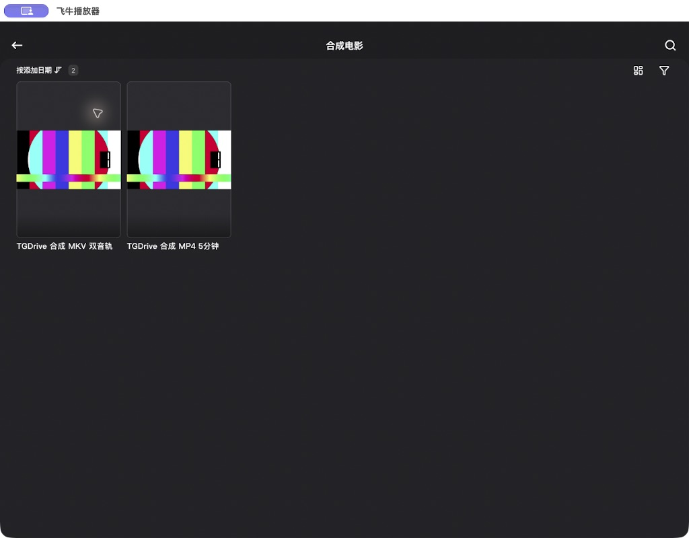
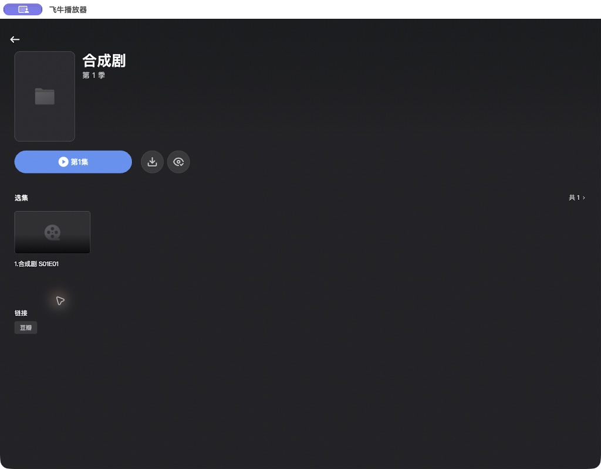

# 飞牛影视完整宿主原生验收记录

日期：2026-11-06，Asia/Shanghai。

状态：指定官方客户端连接包含本轮修复的完整 TGDrive 隔离宿主，已完成首期核心播放集合及电视剧库、季页首集起播验收。全部临时宿主已停止，测试登录记录已移除。公开 `v0.3.5` 标签仍指向原提交，本轮发现的兼容修复需要进入后续宿主发布。

## 源码与安装包

验收源码从已发布标签 `v0.3.5` 导出，基线提交为 `ec3c49ac8a340eac4cf249e3b05e942711b943b4`。本轮开始时主分支为 `0641c6e7336a6770f316c23d99fb69a6641f7832`，相对该标签只修改了镜像工作流。源码夹具保留在本地 `tmp/fntv-native-acceptance-20261106/host-V7uDKa/`，未包含主工作区的搜索、分享及原生客户端接口改动。

实际宿主版本字段仍为 `0.3.5`。原生测试时叠加的运行代码仅为 `src/apps/fntv/protocol.rs`；回归修改位于 `src/apps/fntv_tests.rs`。本地夹具另外增加脱敏请求审计，未将审计代码接入产品服务器。

| 实际窗口 | 协议源码 SHA256 | 本轮原生范围 |
| --- | --- | --- |
| `resume-session-6` | `e82a1ab0054c7ba5f014eb314b9090f7abed82fb7cc708f452610a2f68ad8da5` | 电影库、MP4 播放与续播、MKV 双音轨与外挂 SRT、电视剧页面；发现季页播放定位缺口 |
| `resume-session-7` | `43369c47e563a616ce183e815609a0140bcbc2049a4db048b193b4b1ab67f9a9` | 最终分组播放定位、季页首集实际解码和进度、停服及客户端清理 |

每个窗口的 `runtime-provenance.json` 记录基线、未提交修复状态与文件摘要。根目录早期的 `provenance.json`、`fixture-diagnostics.json` 描述首次标签验收准备，不能替代后续窗口的源码记录。

使用的安装包为此前生成且未改动的 `fntv-0.1.0.tgapp`，11833 字节，最低宿主字段 `0.3.5`：

```text
SHA256 e6d33121415fde364729b2ed820e712e85881f82722a3c6c0b9e6cc45e744779
```

包保留在本地 `tmp/fntv-host-validation-20261105/packages-final/fntv-0.1.0.tgapp`，每个新窗口均校验摘要，再通过真实应用中心安装 API 安装、授权、设置独立账号和两个媒体库，并主动启动。应用中心管理页的交互验收见 [2026-11-05 记录](fntv-host-verification-20261105.md)。本轮没有重建或发布插件分发资产。

## 客户端与隔离范围

客户端仍为用户指定的官方飞牛播放器 `1.12.3 (1123003)`，bundle ID `com.trim.media.ios`，iOS/iPadOS 包在本机 Mac 的兼容运行路径。重新核对了安装包版本与运行进程，未修改应用包。连接使用服务根地址与本地 HTTP。

Rust 宿主仅监听 `127.0.0.1:55393`，使用临时 SQLite、内存 Telegram 和已校验的合成素材。视频为 300 秒、1080p SDR、H.264 加两条 AAC 音轨，素材含 MKV 内嵌 SubRip 与同目录外挂 SRT。本轮没有读取生产配置、连接生产数据库或 Telegram、操作真实媒体及真实账号。收尾再次核对四个素材文件的 SHA256，全部未变。

Node 脚本负责安装配置和只读观察。实际登录、索引、元数据探测、原文件响应及进度事务均由完整 Rust 宿主处理。观察脚本不调用播放协商、原文件下载或进度写入；查询媒体描述可能触发真实有界探测，不夺取播放权威。

请求审计只保存路径、状态、字段类型、合成媒体身份、位置和内存比较序号。密码、登录令牌、完整请求头、客户端关联值及其哈希均不落盘。审计与程序观察分别使用独立文件。

## 发现并修复的兼容问题

### 媒体库详情

客户端进入媒体库时实际请求 `GET /v/api/v1/mdb/{library_guid}` 和 `GET /v/api/v1/item/{library_guid}`。标签源码返回 404，客户端显示服务器错误。

新增媒体库描述与不可播放的目录详情，复用列表描述，并通过当前有效根目录和授权解析库身份。不存在或已撤权的库返回 404，未登录返回 401；不凭旧配置暴露已撤权目录。

### 观看位置的 JSON 数值类型

补齐详情后，宿主返回两条电影，客户端仍显示“无数据”。原始 JSON 中 `watched_ts` 为浮点文本 `0.0`。将作品、最近播放列表与续播信息的位置统一输出为整数秒后，官方客户端立即显示两条电影、数量及封面。

内部进度继续保存有效上报的小数精度，兼容接口返回已播放的完整秒数。回归验证有效 `207.75` 秒仍存为 `207.75`，接口返回整数 `207`；文件日期与轨道日期继续使用毫秒，时长与位置使用秒。毫秒误报、超时长和负位置继续被拒绝。



### 剧和季的默认播放定位

电视剧库、剧页及季页已显示，但季页“第 1 集”实际以季 GUID 调用 `/v/api/v1/play/info`，原实现只能解析作品或文件 GUID，返回 404。

播放信息和媒体描述现在可以将剧、季身份解析为当前授权的首个剧集，按季、集号和 GUID 稳定排序。响应返回实际剧集及文件身份，剧、季详情仍保持自身类型；原文件 Range 仍使用作品或文件身份。媒体库自身不能作为播放目标，撤权后的分组不能读取播放信息或轨道。

回归使用两集验证选中第 1 集、保留该文件进度，并检查未登录、库标识及撤权边界。占位媒体的缓存仅用于回归，不作为原生播放或真实探测证据。



## 实际播放结果

| 内容 | 观察到的结果 |
| --- | --- |
| MP4 起播 | 官方播放器显示持续变化的合成时间码，实际解码通过 |
| MP4 暂停与恢复 | 暂停后画面保持，进程声音测量没有输出；恢复后继续解码 |
| MP4 拖回与续播 | 拖回 `03:26`，宿主保存 206 秒；退出后显示“继续播放”，从该位置继续解码，随后进度更新到 224、239、254 秒等 |
| 非零 Range | MP4 续播阶段收到多次非零起点的原文件请求，返回 206；不能把最初预取尾段的请求单独当作拖动证据 |
| MKV 起播 | 合成 MKV 实际解码，画面时间码持续变化 |
| MKV 第一音轨 | 8 秒定向进程测量约 `442.59 Hz`，对应 440 Hz 合成音轨 |
| MKV 播放中切轨 | 播放器中选择第二条音轨，8 秒实际声音输出约 `882.55 Hz`；上报的音轨 GUID 同时改变 |
| 外挂 SRT | 明确选择“未知-外挂 / SRT / 合成 MKV.srt”，真实字幕下载返回 200，中文字幕在视频画面中渲染 |
| 电视剧组织 | 官方客户端显示一部剧、第一季及第一集，并显示探测得到的 5 分钟时长 |
| 季页首集起播 | 以季 GUID 查询成功，实际原文件解码；客户端用真实剧集与文件 GUID 上报，39 秒进度保存成功 |
| 停止服务 | 管理接口返回 `running:false`；旧客户端偏好、进度及退出请求返回 401，客户端回到登录页，活动读取者为 0 |


声音测量只采集重新核对的指定播放器进程，使用临时私有 Tap 和聚合设备。两次音轨测量均有信号，销毁状态全部为 0，默认输出设备保持不变，未保存原始音频。

`/stream.ip` 的比较序号在多次播放协商中保持相同，实际 `play_link` 不与它相等。MP4 退出续播生成新关联标识，MKV 播放中切轨复用原关联标识且未重新协商 `/stream`。本轮保守绑定接受这些合法上报；MP4 退出后的迟到上报被忽略。该结论只覆盖观察到的流程，标识仍不作为访问凭据。

客户端通常约每 15 秒上报一次进度。退出请求与最后上报并发，退出后的上报可能被忽略，续播使用最近有效位置，不伪造精确退出时刻。

## 构建与程序检查

以下在不含主工作区其他改动的隔离源码中实际执行：

| 命令 | 结果 |
| --- | --- |
| `cargo test --locked fntv_tests:: -- --nocapture` | 0；12 passed、2 ignored |
| `cargo test --locked --quiet` | 0；372 passed、6 ignored |
| `cargo clippy --locked --all-targets -- -D warnings` | 0 |
| 显式合成目录，`cargo test --locked fntv_real_probe -- --ignored --nocapture` | 0；两组真实探测通过 |
| 显式 `fntv_native_fixture` | 0；最终窗口主动停止并正常退出 |
| `git diff --check` | 0 |

真实探测的 MP4、MKV 时长均为 300 秒，每种实际范围读取合计 1048576 字节，重复请求命中缓存。并发为 2、等待队列为 0，停用取消通过；超时约 10006 ms，实际读取 262144 字节。这里记录夹具读取量，不是生产 Telegram 流量。

本轮插件代码、包及主站前端未修改，没有将 2026-11-05 的 npm 日志写成本轮重跑。此前独立插件检查及管理页结果保持原记录。

## Docker 与分发状态

已重新读取 [v0.3.5 重建运行](https://github.com/lengyuesky/tgdrive/actions/runs/42156246379)：TGDrive 与 Telegram Bot API 的 AMD64、ARM64 原生构建、镜像运行检查和多架构清单均成功。TGDrive 两种架构都实际通过 FFprobe 与服务健康检查，解决了 2026-11-05 完整镜像验收的旧阻碍。

该运行使用原 `v0.3.5` 源码。本轮协议修复没有移动既有 Git 标签，也没有替换正式 `0.3.5` 镜像。公开插件目录仍只有原三款应用；让 fntv 在应用中心直接显示，需要在包含这些修复的宿主发布之后，同步发布候选包、`catalog.json` 与 `SHA256SUMS`。

## 收尾与范围

全部本任务窗口仅使用同一回环端口，停止回执确认端口关闭。最终两个原生窗口的活动读取者均为 0，最后夹具正常退出。客户端唯一的 `fntv-local / 127.0.0.1:55393` 合成登录记录已移除，历史页无记录，地址、账号、密码为空，记住密码未选中，HTTPS 默认选项已恢复。没有整体清理客户端缓存，原合成文件及证据保留。

原始证据保存在本地 `tmp/fntv-native-acceptance-20261106/`，包括各窗口来源、脱敏请求、只读观察、声音测量、截图、回归日志和停服回执，不随源码上传。

本轮通过的是指定客户端、本地 HTTP、合成 1080p SDR H.264/AAC 的明确播放集合。其他设备、HTTPS、4K/HDR、图片字幕、MKV 单独的拖动及退出续播、MP4 第二音轨和内嵌字幕渲染未逐项验证。电视剧额外拖动尝试未改变位置，没有将它计为通过；季页首集起播与实际进度保存已有独立证据。日常服务未部署。
