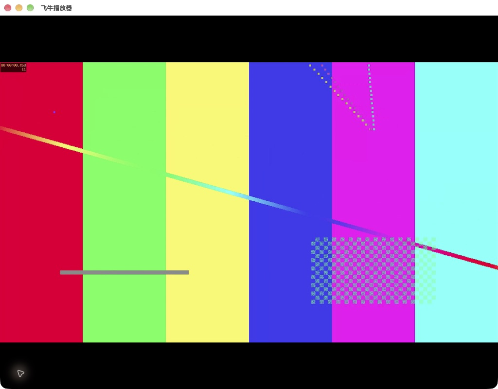

# 飞牛播放器根地址接入实测记录

2026-11-04 已完成后续首验核心播放核验，并清理三个合成客户端连接和测试服务。当前结论见 [播放续验记录](fntv-playback-verification-20261104.md)；以下保留 2026-11-03 结束时的历史结果，锁屏阻碍及待清理条目不再代表当前状态。

2026-11-03 续验已确认：指定官方客户端可以登录根地址夹具、显示合成媒体库与封面，并解码合成 MP4 的真实视频画面。完整播放集合仍未通过；末次电脑控制工具报告 Mac 锁屏且自动解锁失败，后续原生操作因此停止。

本次使用本机已安装的飞牛播放器 `1.12.3 (1123003)`，bundle ID `com.trim.media.ios`，为 iOS/iPadOS 包在 Mac 上的兼容运行。版本及构建已重新读取应用包元数据核对。本记录仅覆盖本机、本地 HTTP 和合成内容。

## 当前验收结果

| 项目 | 结果 | 证据与限制 |
| --- | --- | --- |
| 根地址握手、密码登录 | 通过 | 官方客户端请求握手与 v2 登录接口，合成凭据匹配，随后进入首页并请求用户信息。 |
| 媒体库、列表、数量、封面 | 通过 | 官方首页显示一个合成库、两条视频及封面，全部与电影数量均显示 2。 |
| MP4 起播、视频解码画面 | 已观察到 | 合成视频的动态图案和内置时间码出现在官方播放器中；截图见下文。 |
| 鉴权后的原文件 Range | 已观察到 | 官方客户端请求 MP4 原文件，夹具返回带正确区间的 206；程序自检另行核对原字节。 |
| 暂停、恢复 | 未确认 | 对 10 秒片段的操作尝试未取得可持续核对的暂停状态，不据截图文件名认定通过。 |
| 拖动、退出后续播 | 未通过验收 | 旧夹具的进度上报和退出接口返回错误；新候选处理已通过自检，尚未完成官方客户端续验。 |
| MKV 播放、双音轨切换、文本字幕渲染 | 未验证 | 已准备对应素材和轨道描述，界面展示信息不等于实际切换或渲染通过。 |
| 完整宿主能力、可安装插件与生命周期 | 尚未开始 | 按已确认的实施顺序，继续等待指定客户端的接入和播放关卡完成。 |

这张图是原始客户端截图的副本，证明视频画面已解码。它不证明暂停、拖动、字幕、双音轨或声音输出已通过。

## 已观察到的协议

- 根地址握手包含 `GET /trimcon`、`GET /v/api/v1/sys/version` 和配置请求。
- 官方客户端使用 `POST /v/api/v2/user/loginByPassword`，字段包含 `username`、`password`、`device`、`app_name`、`lan`；合成密码的 SHA-256 摘要匹配，明文和 MD5 候选不匹配。
- 登录响应的 `code/msg/data.token` 组合及合成的非管理员用户信息被客户端接受。后续请求可同时带 Authorization、Cookie 与 Authx；纯 Authx 算法的官方实际签名仍待独立核对，不能用夹具自身签名测试替代。
- 已观察到媒体库、条目、媒体描述和播放信息接口，以及 `GET /v/api/v1/media/range/{media_guid}`。原画起播阶段没有实现或调用夹具的服务端转码。
- 封面实际请求路径为 `/v/api/v1/sys/img/synthetic/poster.jpg`。只映射固定合成图片，不转发图片请求。

第三版条目响应返回 200，客户端仍显示服务器错误；第四版补充 `single_child_guid`、`file_name` 等字段，调整媒体信息中的数组/空值，并补齐图片路径后，列表正常显示。本次同时改变了多个候选字段，尚不能确定其中哪个字段单独造成旧错误，也不能把当前组合当作官方最小 JSON 规范。

第四版成功观察到 MP4 原字节 Range 与解码画面，但进度上报返回 400、退出上报返回 405。进度请求携带一个 12 字符的字幕关闭标记；本次仅只读检索了应用代码中的 `no_subtitle` 字符串，未读取客户端账号配置。第五版实验性处理 `no_subtitle` 和 `_no_subtitle`，并保存匹配类型的布尔诊断；实际官方标记仍需下轮确认。

第四版将秒级文件时间交给客户端，详情页显示为 1970 年。第五版改用真实文件的毫秒时间作为候选格式，已完成程序核验，正确日期的原生显示仍待确认。

## 独立夹具与最终自检

第五版说明保留在本地 `tmp/fntv-validation-20261103/playback-v5-qtvLwa/README.md`。它只监听 `127.0.0.1`，只提供固定合成账号、视频、图片和字幕，不连接 TGDrive 数据库、Telegram、真实 fnOS 或其他视频源。

新的 MP4/MKV 为约 5 分钟、1080p、8 bit、H.264 Constrained Baseline，均有两条 AAC 音轨；MKV 另含 SubRip 文本字幕，夹具同时提供固定外部 SRT。FFprobe 已核对 `tv` 范围及 BT.709 色彩空间、传递函数和原色。初次缺少部分颜色标签的素材副本留在 `fixtures/unvalidated-color/`，当前使用补齐并重新核验的版本。

最终 55 次自检请求通过，覆盖以下范围：

- 合成密码摘要校验、错误凭据与超限正文拒绝、会话鉴权、目录范围和分页上限。
- MP4/MKV 原字节、首段/后缀/非零偏移 Range、HEAD、416、字幕 UTF-8 原字节。
- 进度回退、媒体身份不匹配拒绝、字幕关闭候选、退出上报及有上限的内存设置。
- 停止夹具时中断正在传输的响应、记录未完成状态、清除会话并关闭监听端口。
- 诊断不保存密码、密码摘要、会话 token、签名或原始请求正文；允许记录有界的合成播放位置。

第五版对合成视频传输设置约 768 KiB/s 的测试限速，以便在下一轮向尚未缓冲的区间拖动。测试会话在内存中保留最多 120 分钟，停止服务即撤销；这些参数是临时夹具参数，尚未确定生产服务的探测或会话参数。

第五版启动后收到 295 次旧登录会话的背景请求，全部未经当前会话鉴权，没有新的官方登录提交。因此不能将这些请求计为第五版登录、播放、拖动或字幕通过。55 次程序自检也不能代替官方客户端结果。

## 停止状态与续验入口

本轮三次原生测试服务均已停止。最后使用的 `127.0.0.1:55661` 已核验拒绝连接。客户端内仍保留本次任务创建的两条合成连接（端口 53131、55661），因 Mac 锁屏尚未清理；未改动真实连接和账号。

解锁后以第五版夹具重新建立合成登录，依次核验暂停/恢复、向未缓冲区间拖动、退出后续播、MKV、两条音轨及文本字幕。确认字幕关闭标记和时间单位后，收窄实验候选，再按 [总体设计](fntv-compatibility.md)推进宿主受限能力及应用中心安装包。

本次续验没有修改宿主运行代码，没有提交、推送或部署。

## 本地证据

以下路径相对宿主工作区，原始证据不随源码提交。

- 登录链路：第二版原生请求 `tmp/fntv-validation-20261103/root-address-Ser8I1/native-v2-run-RrfDG3/requests.jsonl` 及同目录的字段/鉴权诊断。
- 列表、媒体描述与 MP4：第四版原生证据 `tmp/fntv-validation-20261103/root-address-Ser8I1/native-v4-run-DrCOGT/`；原始截图和 `probe-source.mjs` 均保留。
- 当前夹具：第五版脚本 `tmp/fntv-validation-20261103/playback-v5-qtvLwa/root-probe-v5.mjs`、最终自检 `tmp/fntv-validation-20261103/playback-v5-qtvLwa/self-test-v5-run-Z3ytjf/report.json`、当前状态 `tmp/fntv-validation-20261103/playback-v5-qtvLwa/verification.json` 及同目录哈希清单。
